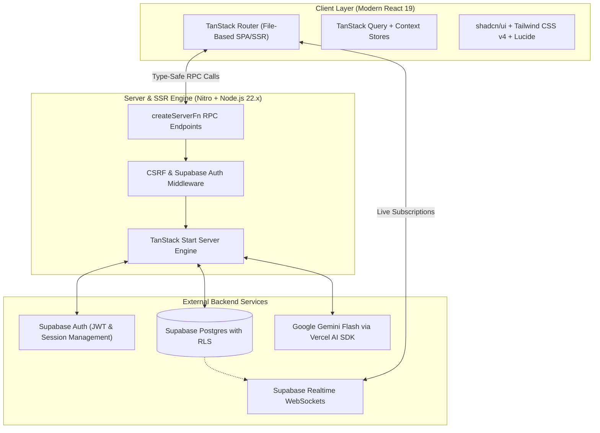

<div align="center">

# 🚀 AI Placement Companion

<p align="center">
  
</p>

<p align="center">
  <strong>A full-stack, AI-driven SaaS built to transform campus placement preparation into an automated, structured, and gamified journey.</strong>
</p>

<p align="center">
  <a href="https://ai-interview-companion-fawn.vercel.app/">
    
  </a>
  <a href="#-instant-demo-access-credentials">
    
  </a>
  <a href="https://github.com/vanshika20006/Ai_Interview_Companion">
    
  </a>
</p>

<p align="center">
  
  
  
  
  
  
  
  
</p>

---

</div>

## 🎯 Instant Demo Access & Testing Credentials

Evaluators, recruiters, and visitors can immediately test all platform features without registering a new account. Use the verified demo credentials below:

<div align="center">

| Field | Value | Action |
| :--- | :--- | :--- |
| **🌐 Live Application** | [**ai-interview-companion-fawn.vercel.app**](https://ai-interview-companion-fawn.vercel.app/) | Click to open in browser |
| **🔑 Demo Email** | `kaurharsimran660kjjjjjj@gmail.com` | Paste into login screen |
| **🔒 Demo Password** | `QHm6mM-Q?p75NWCR` | Paste into login screen |

</div>

> **💡 Quick Walkthrough After Login:**
> 1. Head to **[AI Interview](https://ai-interview-companion-fawn.vercel.app/interview)** to take an active mock interview session or generate a custom one (choose role, difficulty, and question count).
> 2. Open **[Resume Analyzer](https://ai-interview-companion-fawn.vercel.app/resume)** to inspect ATS score calculation, missing technical keywords, and actionable rewrite recommendations.
> 3. Check out the **[LeetCode Roadmap](https://ai-interview-companion-fawn.vercel.app/leetcode)** with 45+ curated problems, category filters, and progress tracking.
> 4. Test the **[Code Review](https://ai-interview-companion-fawn.vercel.app/code-review)** tool for instant AI code quality, time complexity, and security feedback.
> 5. Review **[Analytics](https://ai-interview-companion-fawn.vercel.app/analytics)** to see readiness gauges, weak spot detection, and historical performance charts.

---

## 📸 Platform Preview

<div align="center">
  
</div>

---

## 🌟 Comprehensive Feature Suite

### 1. 🎙️ AI Mock Interview Simulator
- **Adaptive Question Generator**: Dynamically crafts role-specific technical and behavioral questions tailored to target job titles (Full Stack, Backend, SDE, Frontend, AI/ML) and difficulty levels.
- **Interactive Test Runner**: Clean, distraction-free test interface supporting text responses, live answer editing, and instant submission.
- **Gemini-Powered Scoring Matrix**: Generates a deep multi-dimensional scorecard evaluating technical accuracy, communication clarity, problem-solving, and confidence.
- **Historical Session Management**: Resume in-progress tests anytime with persistent storage and delete unwanted sessions.

### 2. 📄 AI Resume Analyzer & Builder
- **Instant ATS Compatibility Score**: Parses resume text and calculates algorithmic match ratings against industry standards.
- **Keyword & Skill Gap Detection**: Pinpoints missing tools, libraries, and architectural concepts for target roles.
- **Actionable Bullet Rewrites**: Suggests quantified XYZ-format bullet points powered by Gemini.
- **Live Resume Builder**: Interactive editor with responsive preview, clean section management (Education, Experience, Projects, Skills), and instant PDF download.

### 3. 🛣️ Curated LeetCode Roadmap
- **Structured Learning Track**: 45+ handpicked coding challenges across 19 critical placement topics (Arrays, Two Pointers, Sliding Window, Trees, Dynamic Programming, Graphs).
- **Personal Solution Notes**: Save personal code explanations, edge-case reminders, and time/space complexity notes per problem.
- **Live Progress Visualization**: Visual progress bars and topic completion ratios connected to Supabase Postgres.

### 4. 💻 AI Code Review Assistant
- **Automated Static Analysis**: Submit any code snippet in Python, Java, C++, or JavaScript/TypeScript.
- **Deep Code Inspections**: Detects logical bugs, security vulnerabilities, edge-case oversights, and bad practices.
- **Big-O Complexity Estimation**: Calculates time and space complexities with refactoring suggestions.

### 5. 📅 Adaptive 7-Day Study Planner
- **Dynamic Weekly Schedule**: Auto-generates personalized daily tasks focusing on weak topics detected from mock interviews and resume gaps.
- **Checklist Accountability**: Mark tasks complete day-by-day to maintain consistency leading up to placement drives.

### 6. 💼 Smart Jobs & Opportunity Portal
- **Candidate Skill Match %**: Ranks placement drives and job postings based on candidate profile skills.
- **Direct Skill Gap Analysis**: Highlights what skills you already possess vs. what you need to learn before applying.

### 7. 👥 Community Forum & Study Groups
- **Real-Time Discussions**: Channels for placement discussions, off-campus drive updates, and interview experiences via Supabase Realtime.
- **Nested Comments & Upvotes**: Engage with peers, ask doubts, and share preparation resources.
- **Collaborative Study Groups**: Create or join focused prep circles with fellow students.

### 8. 📊 Readiness Analytics & Gamification
- **Placement Readiness Index**: Holistic 0–100 readiness gauge computed across resume quality, mock interview scores, and coding completion.
- **Interactive Recharts**: Visual charts for score improvements, category breakdowns, and weekly activity.
- **Daily Streaks & Leaderboard**: Earn badges, unlock achievements, and compete on the global college leaderboard.

### 9. 🌐 Public Portfolios & Recruiter Hub
- **Shareable Portfolios (`/u/:username`)**: Showcase your verified readiness score, top skills, projects, and interview track record with custom share-cards.
- **Recruiter Search Engine**: Recruiters can filter candidates by skills, ATS range, and interview scores, and save matches to custom candidate shortlists.

---

## 🏗️ High-Level System Architecture



---

## 🛠️ Technology Stack

| Layer | Technologies |
| :--- | :--- |
| **Frontend Framework** | **React 19**, **TypeScript 5 (Strict Mode)** |
| **Routing & Full-Stack Engine** | **TanStack Start (v1)**, **TanStack Router**, **TanStack Query** |
| **Styling & UI Components** | **Tailwind CSS v4**, **shadcn/ui**, **Radix UI**, **Lucide React**, **Sonner** |
| **Data Visualization & Export** | **Recharts**, **jsPDF**, **html2canvas-pro** |
| **Backend & Database** | **Supabase Postgres**, **Row Level Security (RLS)**, **Supabase Auth**, **Supabase Realtime** |
| **AI & LLM Services** | **Google Gemini 2.0 / 1.5 Flash** (via Vercel AI SDK `@ai-sdk/google`) |
| **Build Tools & Serverless Engine** | **Vite 8**, **Nitro Engine**, **Node.js 22.x**, **Vercel Serverless Functions** |

---

## 🗂️ Project Organization

```
AI Placement Companion/
├── .vercel/                         # Vercel deployment & serverless function output
├── public/                          # Static assets, PWA manifest, and app icons
├── src/
│   ├── components/                  # Reusable UI components & shadcn primitives
│   │   ├── ui/                      # Base UI library (buttons, cards, dialogs, etc.)
│   │   ├── app-sidebar.tsx          # Navigation sidebar with reactive routes
│   │   ├── command-palette.tsx      # Quick search dialog (Cmd+K / Ctrl+K)
│   │   └── resume-preview.tsx       # Live resume renderer
│   ├── integrations/supabase/       # Supabase client, auth attachers, and types
│   ├── lib/                         # Server functions and shared utilities
│   │   ├── ai-provider.server.ts    # Gemini AI SDK instance
│   │   ├── interview.functions.ts   # Mock interview generation & evaluation RPCs
│   │   ├── resume.functions.ts      # ATS analysis & scoring RPCs
│   │   ├── planner.functions.ts     # Study plan generator RPCs
│   │   └── readiness.ts             # Algorithmic readiness calculations
│   ├── routes/                      # TanStack Router file-based route hierarchy
│   │   ├── __root.tsx               # Root route with theme & toast providers
│   │   ├── index.tsx                # Public marketing landing page
│   │   ├── auth.tsx                 # Authentication (Login / Sign Up)
│   │   ├── u.$username.tsx          # Public candidate portfolio view
│   │   └── _authenticated/          # Protected application subtree
│   │       ├── dashboard.tsx        # Main student hub & overview
│   │       ├── interview.tsx        # Interview simulator layout
│   │       ├── interview.index.tsx  # Interview session dashboard
│   │       ├── interview.$id.tsx    # Live interactive test runner
│   │       ├── resume.tsx           # AI Resume Analyzer
│   │       ├── resume-builder.tsx   # Interactive Resume Builder
│   │       ├── leetcode.tsx         # LeetCode 45+ Roadmap
│   │       ├── code-review.tsx      # AI Code Reviewer
│   │       ├── planner.tsx          # 7-day adaptive planner
│   │       ├── analytics.tsx        # Deep readiness metrics & graphs
│   │       ├── jobs.tsx             # Smart job matching portal
│   │       ├── community.tsx        # Peer discussion forums
│   │       ├── groups.tsx           # Study groups
│   │       └── recruiter.tsx        # Recruiter talent discovery hub
│   ├── router.tsx                   # TanStack Router instance & QueryClient
│   ├── server.ts                    # Nitro serverless request handler
│   ├── start.ts                     # TanStack Start configuration & middlewares
│   └── styles.css                   # Global Tailwind CSS v4 styling & color tokens
├── nitro.config.ts                  # Nitro deployment configuration (nodejs22.x)
├── vite.config.ts                   # Vite bundler configuration
└── package.json                     # Dependencies & execution scripts
```

---

## ⚙️ Local Development Setup

Follow these steps to run the complete environment on your local machine:

### 1. Prerequisites
- **Node.js** v20.x or v22.x installed ([Download Node.js](https://nodejs.org/))
- **Git** installed ([Download Git](https://git-scm.com/))

### 2. Clone Repository
```bash
git clone https://github.com/vanshika20006/Ai_Interview_Companion.git
cd "Ai_Interview_Companion"
```

### 3. Install Dependencies
```bash
npm install
```

### 4. Configure Environment Variables
Create a local `.env` file based on `.env.example`:
```bash
cp .env.example .env
```

Ensure your `.env` contains:
```env
# Client-side visible Supabase configuration
VITE_SUPABASE_URL=https://your-project.supabase.co
VITE_SUPABASE_PUBLISHABLE_KEY=your-supabase-anon-key
VITE_SUPABASE_PROJECT_ID=your-project-id

# Server-side Supabase configuration
SUPABASE_URL=https://your-project.supabase.co
SUPABASE_PUBLISHABLE_KEY=your-supabase-anon-key
SUPABASE_SERVICE_ROLE_KEY=your-supabase-service-key

# AI Engine configuration (Google Gemini)
GEMINI_API_KEY=your-gemini-api-key
# Note: LOVABLE_API_KEY is supported as an alternate key
```

### 5. Start Development Server
```bash
npm run dev
```
Open **[http://localhost:3000](http://localhost:3000)** in your browser.

---

## 🛠️ Build & Verification Scripts

| Script | Purpose |
| :--- | :--- |
| `npm run dev` | Launches local development server with HMR |
| `npm run build` | Compiles client assets and bundles Nitro serverless output targeting `nodejs22.x` |
| `npm run preview` | Previews the compiled production build locally |
| `npx tsc --noEmit` | Performs strict TypeScript type checks across all files |
| `npm run lint` | Runs ESLint validation across the repository |
| `npm run format` | Enforces code formatting via Prettier |

---

## 🚀 Deployment Guide (Vercel)

This application is optimized for deployment on **Vercel** with **TanStack Start** and **Nitro**:

1. **Push your code to GitHub:**
   ```bash
   git add .
   git commit -m "feat: complete AI placement companion implementation"
   git push origin main
   ```

2. **Connect to Vercel:**
   - Go to [Vercel Dashboard](https://vercel.com) and click **Add New > Project**.
   - Select your `Ai_Interview_Companion` repository.
   - Framework preset is automatically recognized as **TanStack Start**.
   - Node.js Version in Vercel project settings: **`22.x`**.

3. **Set Environment Variables on Vercel:**
   - Under **Project Settings > Environment Variables**, add:
     - `VITE_SUPABASE_URL`
     - `VITE_SUPABASE_PUBLISHABLE_KEY`
     - `SUPABASE_URL`
     - `SUPABASE_PUBLISHABLE_KEY`
     - `GEMINI_API_KEY`
     - `DANGEROUSLY_DEPLOY_VULNERABLE_TANSTACK_START_XSS = 1`

4. **Deploy:** Click **Deploy** to publish the production URL!

---

## 🤝 Contributing

Contributions, feature suggestions, and bug reports are welcome!
1. Fork the Project
2. Create your Feature Branch (`git checkout -b feature/AmazingFeature`)
3. Commit your Changes (`git commit -m 'feat: Add some AmazingFeature'`)
4. Push to the Branch (`git push origin feature/AmazingFeature`)
5. Open a Pull Request

---

## 📄 License

Distributed under the **MIT License**. See `LICENSE` for more information.

<div align="center">
  <p>Crafted with ❤️ to help students crack their dream campus placements.</p>
  <a href="https://ai-interview-companion-fawn.vercel.app/"><strong>Explore Placement AI Live →</strong></a>
</div>
